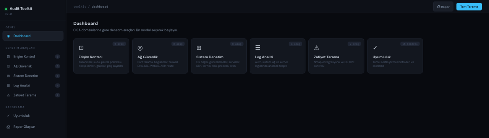
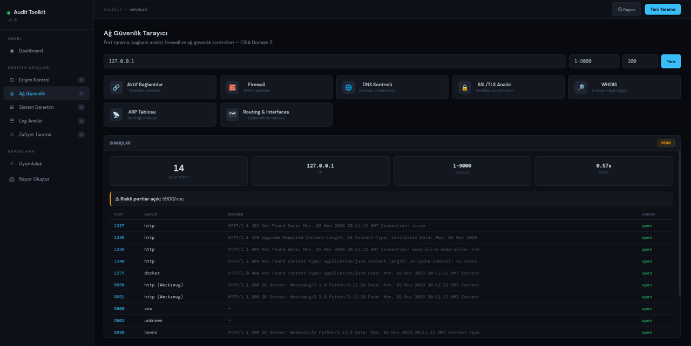
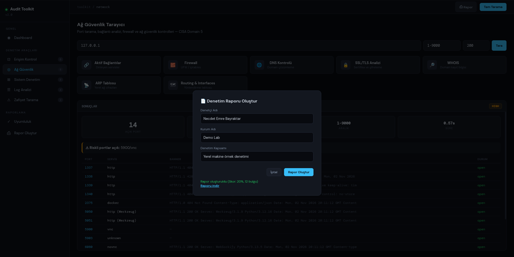
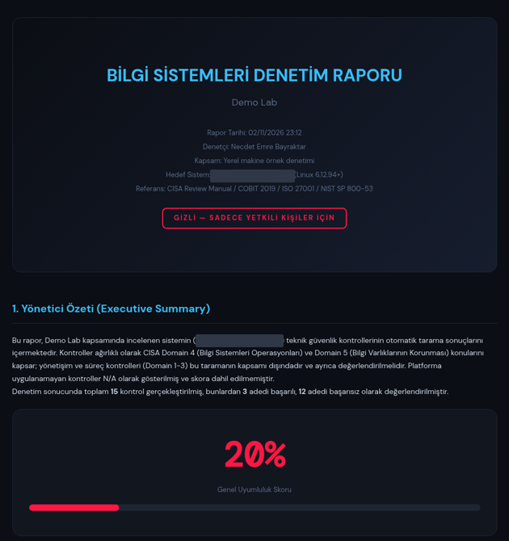

# CISA-Toolkit

Türkçe | [English](#english)

CISA sınavına hazırlanırken IT / BS denetimi pratiği yapmak için yazdığım yerel denetim aracı. Flask ile çalışan, tarayıcıda veya ayrı bir pencerede (pywebview) açılan bir arayüzden, bulunduğu bilgisayarda temel teknik kontrolleri çalıştırır ve sonuçları bulgu formatında bir HTML rapora döker. Kontrolleri CISA alanlarına (domain) göre grupladım; araç ağırlıklı olarak Domain 4 (BS Operasyonları) ve Domain 5 (Bilgi Varlıklarının Korunması) konularını kapsar. Yönetişim ve süreç denetimi (Domain 1-3) otomatik taramayla yapılamayacağı için kapsam dışıdır.

ISACA ile bir bağlantısı yoktur, resmi bir CISA aracı değildir. Bilgi Sistemleri Denetçisi Adayı olarak kendi öğrenme sürecim için hazırladım.

## Modüller

| Modül | Kontroller |
|---|---|
| Erişim kontrolü | Kullanıcı hesapları ve UID 0, sudo / wheel üyeleri, parola politikası (login.defs, PAM), son girişler, kritik dosya izinleri, SUID / SGID dosyalar, gruplar |
| Ağ | TCP port tarama (banner ile), dinleyen servisler, firewall durumu, DNS kayıtları, TLS sertifika kontrolü, WHOIS, ARP ve routing tablosu |
| Sistem | Sistem bilgisi, bekleyen güncellemeler, servisler, SSH yapılandırması, kernel parametreleri (sysctl), cron, süreçler, disk şifreleme |
| Log analizi | Kimlik doğrulama logları ve brute-force belirtisi, sistem, ağ ve kernel logları |
| Zafiyet | Nmap entegrasyonu (kuruluysa), işletim sistemi güvenlik güncellemeleri |
| Uyumluluk | 15 temel sertleştirme kontrolü ve skor. Çalışılan platforma uymayan kontroller N/A olarak gösterilir ve skora katılmaz |
| Rapor | Bulgu, etki, olasılık, risk derecesi, öneri ve yönetim yanıtı alanlarıyla HTML rapor (`cisa-toolkit-pro/reports/`) |

## Kurulum ve çalıştırma

Python 3.9 veya üstü gerekir. Tek zorunlu bağımlılık Flask.

macOS (Linux'ta da aynı adımlar):

1. Terminal'i açın ve Python'u kontrol edin:

   ```bash
   python3 --version
   ```

2. Repoyu indirip uygulama klasörüne girin:

   ```bash
   git clone https://github.com/nemrebayraktar/CISA-Toolkit.git
   cd CISA-Toolkit/cisa-toolkit-pro
   ```

3. Sanal ortam kurup Flask'ı yükleyin:

   ```bash
   python3 -m venv .venv
   .venv/bin/pip install -r requirements.txt
   ```

4. Uygulamayı başlatın. Tarayıcı kendiliğinden açılır, açılmazsa http://127.0.0.1:5050 adresine gidin:

   ```bash
   .venv/bin/python app.py --web
   ```

   Kapatmak için terminalde Ctrl+C.

Kısa yol: macOS'ta Finder'dan `CISA Audit Toolkit.command` dosyasına çift tıklamak yeterli. İlk açılışta sanal ortamı kendisi kurar. Çalıştırma izni yoksa bir kez `chmod +x "CISA Audit Toolkit.command"` verin. pywebview kuruluysa (`.venv/bin/pip install pywebview`) `.venv/bin/python app.py` ayrı bir pencerede açılır.

Windows'ta: `py -m venv .venv`, `.venv\Scripts\pip install -r requirements.txt`, `.venv\Scripts\python app.py --web`.

Varsayılan port 5050'dir (macOS'ta 5000 portunu AirPlay kullanıyor). Port doluysa boş bir port seçilir ve adres terminale yazılır. Elle vermek için `--port 8000`. WiFi Auditor da 5050 kullandığı için ikisi aynı anda açılırsa adresi terminalden kontrol edin.

## Kullanım

Ekran görüntüleri Linux bir test makinesinde alındı. Bilgisayar adını görsellerde kapattım.

1. Dashboard'da modüller ve her modüldeki kontrol sayısı görünür. Soldaki menüden modül seçilir.

   

2. Ağ Güvenlik ekranında hedef, port aralığı ve paralel bağlantı sayısı girilip "Tara" denir. Açık portlar servis adı ve banner bilgisiyle listelenir, riskli portlar ayrıca uyarılır. Aynı ekranda firewall, DNS, TLS, WHOIS, ARP ve routing kontrolleri de var.

   

3. Sağ üstteki "Rapor" butonuyla denetçi adı, kurum ve kapsam girilir. "Rapor Oluştur" uyumluluk kontrollerini çalıştırır, skoru ve bulgu sayısını gösterir, "Raporu indir" bağlantısı çıkar.

   

4. Rapor kapak bilgileri, yönetici özeti, uyumluluk skoru ve bulgu tablosundan oluşur. Her bulguda etki, olasılık, risk derecesi, öneri ve yönetim yanıtı alanları var.

   

Raporlar `cisa-toolkit-pro/reports/` klasörüne `audit_report_<tarih>.html` adıyla kaydedilir. Bu klasör bilgisayar adı ve sistem bilgisi içerdiği için repoya eklenmez.

## Notlar ve kısıtlar

- Kontrollerin çoğu Linux içindir (Debian / Ubuntu ağırlıklı). macOS'ta firewall, disk şifreleme (FileVault), güncellemeler, servisler ve loglar macOS komutlarıyla okunur; Linux'a özgü kontroller N/A gelir. Windows'ta yalnızca port tarama, DNS, TLS ve rapor kısmı anlamlıdır.
- Bazı kontroller (lastb, iptables, /etc/sudoers, auth.log) root yetkisi ister; yetki yoksa sonuç eksik gelir.
- Otomatik tarama sonuçları denetçi doğrulaması yerine geçmez; rapordaki bulgular gözden geçirilmeden nihai kabul edilmemelidir.
- Sunucu yalnızca 127.0.0.1 üzerinde dinler. Başka bir sitenin arka planda istek atması (CSRF / DNS rebinding) engellenmiştir, komutlara giden hedef / alan adı değerleri doğrulanır ve ekrana basılan komut çıktıları kaçırılır.
- Port tarama ve Nmap yalnızca kendi sistemlerinizde veya yazılı izin aldığınız hedeflerde kullanılmalıdır. İzinsiz tarama suçtur (TCK 243-245).

Lisans: MIT ([LICENSE](LICENSE)).

---

## English

A local audit tool I wrote to practise IT / IS audit work while preparing for the CISA exam. It runs on Flask with a browser (or pywebview window) interface, runs basic technical checks on the machine it is started on and turns the results into an HTML report in a findings format. Checks are grouped by CISA domain; the tool mainly covers Domain 4 (IS Operations) and Domain 5 (Protection of Information Assets). Governance and process audit work (Domains 1-3) cannot be automated this way and is out of scope.

It is not affiliated with ISACA and is not an official CISA tool. I built it for my own learning as an aspiring IS auditor.

Modules: access control (accounts, sudo, password policy, logins, file permissions, SUID / SGID, groups), network (TCP port scan with banners, listening services, firewall, DNS, TLS certificate check, WHOIS, ARP and routes), system (updates, services, SSH config, sysctl, cron, processes, disk encryption), log analysis (auth logs and brute-force signs, system, network, kernel), vulnerability (Nmap if installed, OS security updates), compliance (15 hardening checks with a score; checks that do not apply to the platform are shown as N/A and excluded from the score) and an HTML report with finding, impact, likelihood, risk rating, recommendation and management response fields.

Setup and run (macOS, Linux is the same). Python 3.9+ is needed and Flask is the only required dependency.

1. Check Python: `python3 --version`
2. Get the code:

   ```bash
   git clone https://github.com/nemrebayraktar/CISA-Toolkit.git
   cd CISA-Toolkit/cisa-toolkit-pro
   ```

3. Create a virtual environment and install Flask:

   ```bash
   python3 -m venv .venv
   .venv/bin/pip install -r requirements.txt
   ```

4. Start it with `.venv/bin/python app.py --web`. The browser opens by itself; if not, go to http://127.0.0.1:5050. Stop it with Ctrl+C.

On macOS you can also double-click `CISA Audit Toolkit.command`, which sets up the virtual environment on first run (run `chmod +x "CISA Audit Toolkit.command"` once if it is not executable). With pywebview installed, `.venv/bin/python app.py` opens a separate window. On Windows use `py -m venv .venv`, `.venv\Scripts\pip install -r requirements.txt`, `.venv\Scripts\python app.py --web`. The default port is 5050 (macOS uses 5000 for AirPlay); if it is busy a free port is chosen and printed, or use `--port 8000`. WiFi Auditor also uses 5050, so check the terminal for the address if both are running.

Using it: pick a module from the dashboard, run the checks (for example a port scan with banners on the network page), then use the "Rapor" button to enter the auditor name, organisation and scope and generate the report. Reports are saved as `cisa-toolkit-pro/reports/audit_report_<date>.html` and contain the cover details, an executive summary, the compliance score and a findings table. The screenshots above were taken on a Linux test machine with the host name hidden.

Notes: most checks target Linux (mainly Debian / Ubuntu); on macOS the firewall, FileVault, updates, services and logs are read with macOS commands and Linux-only checks show N/A. Some checks need root. Automated results do not replace auditor judgement. The server only listens on 127.0.0.1, blocks cross-site requests, validates targets passed to commands and escapes command output before it is shown. Generated reports contain host details and are not committed. Use port scanning and Nmap only on systems you own or have written permission to test.

License: MIT ([LICENSE](LICENSE)).
